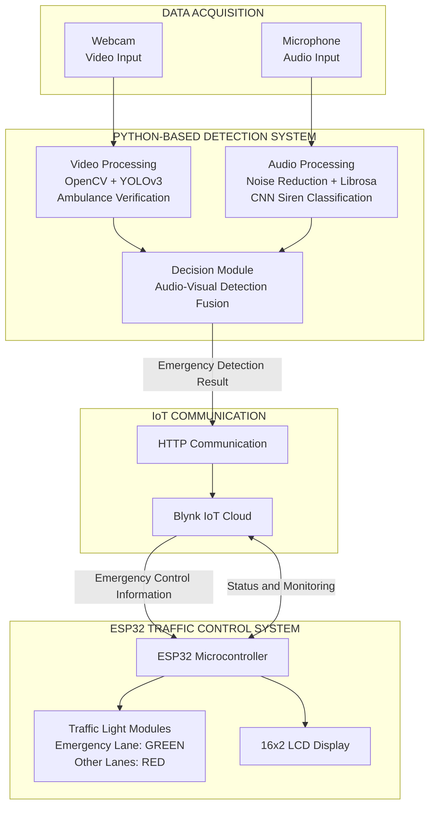
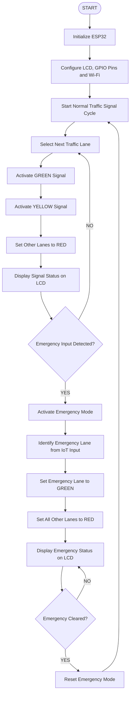

# Siren-Based-Automatic-Traffic-Signal-System
# 🚦 Siren-Based Automatic Traffic Signal System

An intelligent emergency vehicle detection and automatic traffic signal control system using **ESP32, Python, Computer Vision, Deep Learning, and IoT**.

---

## 📌 1. Project Overview

The **Siren-Based Automatic Traffic Signal System** is designed to provide priority to emergency vehicles, such as ambulances, at traffic intersections.

The system combines computer vision and audio processing to identify emergency vehicles. A webcam captures the traffic scene, while a microphone captures surrounding sounds. The captured video and audio are processed using machine learning and deep learning techniques to identify emergency vehicles and siren sounds.

The visual and audio detection results are combined to confirm an emergency condition. The detection result is communicated through the Blynk IoT platform to an ESP32 microcontroller, which controls the traffic signals.

When an emergency vehicle is confirmed, the corresponding traffic lane is given a green signal while the other lanes are assigned red signals. Once the emergency condition is cleared, the system returns to normal automatic traffic signal operation.

The primary aim is to reduce delays for emergency vehicles and support intelligent traffic management.

---

## 🎯 2. Project Objectives

- Detect vehicles and identify emergency vehicles using computer vision.
- Recognize emergency siren sounds using audio classification.
- Combine visual and audio information to improve emergency detection.
- Automatically control traffic signals using an ESP32 microcontroller.
- Integrate IoT-based monitoring and communication.
- Provide priority to emergency vehicles at road intersections.
- Reduce unnecessary waiting time for ambulances and other emergency vehicles.

---

## ⚙️ 3. Key Features

### 🚘 Vehicle Detection
Uses YOLOv3 and OpenCV to detect vehicles from webcam video input.

### 🚑 Emergency Vehicle Verification
Uses image processing techniques, including HSV color masking, to verify ambulance-related visual features.

### 🔊 Siren Sound Detection
Uses audio processing and a Convolutional Neural Network (CNN) to classify emergency and traffic-related sounds.

### 🧠 Audio-Visual Detection Fusion
Combines the visual detection and audio classification results to confirm an emergency condition.

### 🚦 Automatic Traffic Signal Control
Uses an ESP32 microcontroller to control traffic lights and provide priority to the selected emergency vehicle lane.

### 📡 IoT Monitoring
Uses the Blynk IoT platform for system monitoring and communication.

### 🔄 Automatic Mode Switching
Automatically switches between normal traffic operation and emergency traffic operation based on the detection result.

---

## 🛠️ 4. Hardware Components

| Component | Purpose |
|---|---|
| ESP32 Microcontroller | Controls the traffic signal system |
| Traffic Light LED Modules | Represent red, yellow, and green traffic signals |
| 16×2 LCD Display | Displays traffic and emergency status |
| Webcam | Captures real-time traffic video |
| Microphone | Captures siren and surrounding audio |
| Laptop / Computer | Runs the Python-based detection system |
| Wi-Fi Connectivity | Enables IoT communication |

---

## 💻 5. Software and Technologies

| Technology | Application |
|---|---|
| Python | Main application development |
| OpenCV | Image processing and computer vision |
| YOLOv3 | Vehicle detection |
| CNN | Emergency sound classification |
| TensorFlow | Deep learning model implementation |
| Librosa | Audio feature extraction |
| NumPy | Numerical processing |
| Noise Reduction | Reduces unwanted background audio |
| Jupyter Notebook | Model development and testing |
| Arduino IDE | ESP32 programming |
| Embedded C/C++ | Microcontroller programming |
| Blynk IoT | Remote monitoring and communication |
| HTTP | Communication between the detection system and IoT platform |

---

## 🏗️ 6. System Architecture

The proposed system consists of two major sections:

1. **Intelligent Emergency Vehicle Detection System:** Processes video and audio inputs to identify emergency vehicles.
2. **ESP32-Based Automatic Traffic Signal Controller:** Receives the emergency control information and manages the traffic signals.

### 6.1 Overall System Architecture

The following architecture illustrates the complete flow of information from data acquisition to emergency traffic signal control.



### 6.2 Traffic Signal Control Flowchart

The ESP32 operates in two modes:

- **Normal Mode:** Traffic signals operate in a predefined automatic sequence.
- **Emergency Mode:** The identified emergency vehicle lane receives a green signal while all other lanes remain red.



### 6.3 Architecture Description

| Module | Description |
|---|---|
| Data Acquisition | Captures real-time video and audio using a webcam and microphone. |
| Video Processing | Uses OpenCV and YOLOv3 to detect vehicles and verify ambulance-related visual features. |
| Audio Processing | Uses noise reduction, Librosa feature extraction, and CNN classification to identify emergency siren sounds. |
| Decision Module | Combines visual and audio detection results to confirm an emergency. |
| IoT Communication | Sends the detection information to the Blynk IoT platform through HTTP communication. |
| ESP32 Controller | Receives emergency control information and manages the traffic signal sequence. |
| Traffic Light Modules | Provides a green signal to the emergency lane and red signals to the other lanes. |
| LCD Display | Displays the current traffic signal and emergency status. |
| Monitoring | Uses the Blynk platform for system monitoring and communication. |

---

## 🔄 7. System Working Principle

The system operates through the following stages:

**Step 1 – Video Acquisition**

A webcam captures the real-time traffic scene and provides video input to the Python-based detection system.

**Step 2 – Vehicle Detection**

YOLOv3 detects vehicles in the captured video stream. Image processing techniques are used to verify ambulance-related visual features.

**Step 3 – Audio Acquisition**

A microphone captures surrounding traffic sounds, including possible emergency sirens.

**Step 4 – Siren Classification**

The captured audio is processed using noise reduction and feature extraction techniques. Librosa is used for audio feature extraction, and a CNN model classifies the sound.

**Step 5 – Detection Fusion**

The visual and audio detection results are combined by the decision module to confirm the presence of an emergency vehicle.

**Step 6 – IoT Communication**

The detection result is transmitted to the Blynk IoT platform through HTTP communication.

**Step 7 – Traffic Signal Control**

The ESP32 receives the emergency control information and activates emergency mode. The selected emergency vehicle lane receives a green signal, while the other lanes receive red signals.

**Step 8 – Monitoring and Normal Operation**

The traffic and emergency status are displayed on the LCD and monitored through the IoT platform. Once the emergency condition is cleared, the system resumes its normal automatic traffic signal sequence.

---

## 📁 8. Repository Structure

The repository contains the Python detection files, ESP32 program, Jupyter Notebook, YOLO configuration files, and supporting project resources.

```text
Siren-Based-Automatic-Traffic-Signal-System/
│
├── Prediction/
│   ├── Report Content.docx
│   ├── ambulance.py
│   ├── update.py
│   ├── ambulance_video.mp4
│   ├── captured_ambulance.jpg
│   ├── captured_image.jpg
│   ├── coco.names
│   └── yolov3.cfg
│
├── ambulance.ino
├── ambulance.ipynb
├── label_classes.npy
├── README.md
└── LICENSE
```

*Note: Automatically generated folders such as `.idea` and `.ipynb_checkpoints` are excluded from this project structure.*

---

## 🚀 9. Applications

- Smart city traffic management.
- Emergency vehicle prioritization.
- Ambulance and fire truck movement management.
- Intelligent transportation systems.
- Automated traffic signal control.
- Emergency response support at road intersections.

---

## 🔮 10. Future Enhancements

- Real-time deployment using edge AI devices.
- GPS-based emergency vehicle location tracking.
- Coordination between multiple traffic intersections.
- Improved vehicle detection under different lighting and weather conditions.
- Integration with smart city traffic management networks.
- Optimization of emergency vehicle routing.
- Improved audio classification for noisy traffic environments.

---

## 👨‍💻 11. Project Information

| Category | Details |
|---|---|
| Project Title | Siren-Based Automatic Traffic Signal System |
| Controller | ESP32 |
| Programming Languages | Python, Embedded C/C++ |
| Domain | Embedded Systems, IoT, Artificial Intelligence |
| Vehicle Detection | YOLOv3 and OpenCV |
| Siren Detection | CNN and Audio Processing |
| IoT Platform | Blynk |
| Traffic Control | Automatic Signal Prioritization |

---

## 📄 12. License

This project is licensed under the **MIT License**. Refer to the [LICENSE](LICENSE) file for more information.

---

## ⭐ Acknowledgment

This project demonstrates the integration of embedded systems, artificial intelligence, computer vision, audio processing, and IoT technologies to develop an intelligent traffic management solution that prioritizes emergency vehicles.
